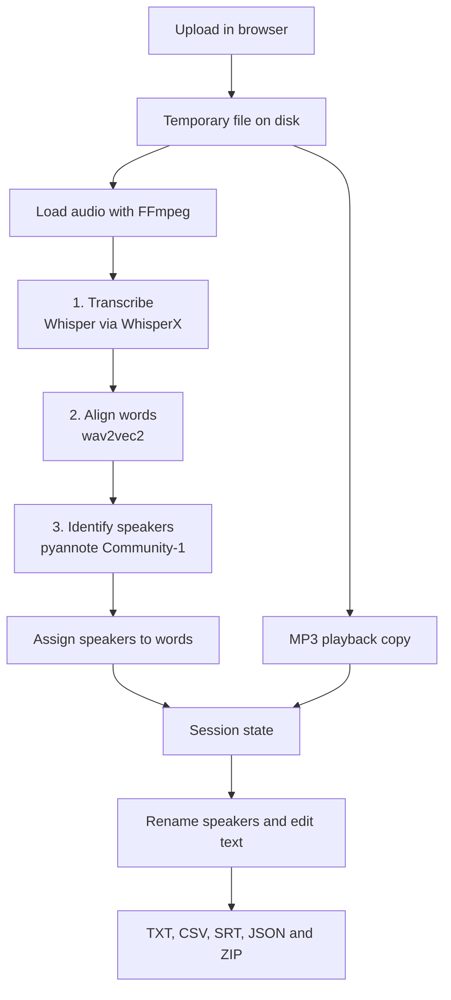
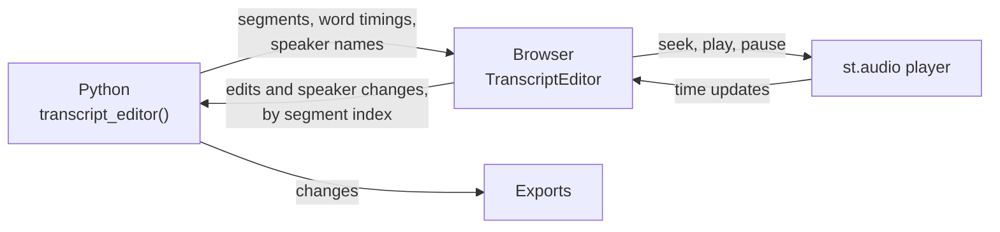

# How it works

This page is for people who want to understand or change the code. You don't need it to use the app.

## Overview

The app is a Streamlit script, `local_transcriber_app.py`, with a separate transcript editor component. It runs three machine learning stages on one recording, lets you review the result, then turns it into export files.

Everything up to "Session state" runs once, when you click **Transcribe + diarize**. Renaming speakers and editing text only rebuild the exports from the stored result, which is why they're instant.

## Pipeline stages

`transcribe_file()` runs these steps in order. Each large model is deleted before the next one loads, and `clear_cuda_cache()` frees GPU memory, so only one is in memory at a time.

| Progress | Step | Details |
| --- | --- | --- |
| 5–17% | Find or download the Whisper model | `ensure_whisper_model_cached()` |
| 18% | Load the audio | `whisperx.load_audio()`, which uses FFmpeg |
| 20% | Load the Whisper model | From the local cache only |
| 22–54% | Transcribe | `model.transcribe()` |
| 55–60% | Find and load the alignment model | Depends on the detected language |
| 60–61% | Find or download sentence data | `ensure_nltk_punkt_tab()` |
| 62–74% | Align words to the audio | `whisperx.align()` |
| 75–80% | Load the speaker model | `DiarizationPipeline`, which uses your token |
| 81–95% | Identify speakers | Constrained to the exact number of speakers |
| 96% | Match speakers to words | `whisperx.assign_word_speakers()` |
| 100% | Finished | Returns the result and run metadata |

`main()` then calls `create_playback_audio()`, while the temporary file still exists.

## The transcript editor

The editor is a Streamlit v2 component. It runs in the app page, with no iframe, and loads nothing from the internet.

- **Data out:** `build_editor_segments()` sends each segment with its text split into timed `parts`. Joining the parts gives back the text exactly, which also keeps the text intact when words have no timings.
- **Data back:** changes are stored as two pieces of component state, `edits` (segment index to corrected text) and `speaker_changes` (segment index to speaker ID). The original result is never changed. The export functions apply both when they run, so undoing a change is just removing it from its map.
- **Audio:** a normal `st.audio` element plays the sound, inside a container with the key `scribe_player`. The editor finds it through the `.st-key-scribe_player` CSS class that Streamlit adds.

## Code map

| Function | Purpose |
| --- | --- |
| `main()` | Builds the page: sidebar, upload, run button, results and downloads |
| `transcribe_file()` | Runs the whole pipeline |
| `create_playback_audio()` | Makes the small MP3 copy for the player |
| `configure_huggingface_downloads()` | Sets download timeouts and the token and Xet behaviour |
| `ensure_whisper_model_cached()` | Downloads Whisper model files one by one, with visible progress |
| `ensure_hf_snapshot_cached()` | The same for other Hugging Face models, used for English alignment |
| `ensure_nltk_punkt_tab()` | Makes sure sentence data is present |
| `resolve_device()`, `resolve_compute_type()` | Turn the sidebar choices into real values |
| `progress_mapper()` | Converts a stage's 0–100% into its share of the overall progress bar |
| `speaker_ids_in_order()` | Lists speakers in order of first appearance |
| `make_display_rows()` | Converts raw segments into simple rows with speaker names and edits applied |
| `merge_turns()` | Joins consecutive segments by the same speaker, for the TXT export |
| `build_txt()`, `build_csv()`, `build_word_csv()`, `build_srt()`, `build_json()`, `build_zip()` | Create the export files |
| `transcript_editor()` (in `transcript_editor.py`) | Shows the editor and returns the text edits and speaker changes |
| `build_editor_segments()`, `build_speaker_options()`, `split_text_into_parts()` (in `transcript_editor.py`) | Prepare the data the editor displays |
| `TranscriptEditor` (in `assets/transcript_editor.js`) | All browser-side behaviour: rendering, highlighting, seeking and editing |

## Design decisions

These choices solve specific problems, so please keep them in mind before you change the related code.

**Model downloads are explicit.** WhisperX can download models by itself, but `faster-whisper` hides the progress, so a slow download looks like a frozen app. The app downloads the files first, shows the progress, and then loads the model with `local_files_only=True`.

**Heavy libraries are imported late.** `torch` and `whisperx` are imported inside functions, so the page opens quickly. It also means environment variables can be set before those libraries load.

**The token is kept away from public models.** `HF_HUB_DISABLE_IMPLICIT_TOKEN=1` and `token=False` stop your token being sent with public downloads. It's passed explicitly, and only to the speaker model.

**English alignment uses Hugging Face.** WhisperX's default English model downloads from `download.pytorch.org`, which is blocked on some networks. The app uses the equivalent `facebook/wav2vec2-base-960h` from Hugging Face instead, so the download follows the same path as the other models. Other languages keep WhisperX's defaults.

**The speaker model isn't downloaded by hand.** Community-1 points to several nested assets. Fetching it manually led to false "config.yaml missing" errors on Windows, so the app leaves this to pyannote's own loader.

**`tqdm_class` support is detected at runtime.** Older versions of `huggingface_hub` don't support the custom progress display, and WhisperX allows a range of versions, so the code checks with `inspect.signature()` instead of assuming one.

**Xet can be switched off.** The newer Xet download backend can stall on some Windows machines and networks. Compatibility mode falls back to regular HTTP, and is on by default for Windows. The setting is also copied into `huggingface_hub`'s constants, because the library may already be imported when Streamlit reruns the script.

**Telemetry is off by default.** pyannote's metrics are disabled at the top of the script with `os.environ.setdefault()`, which has to happen before pyannote is imported. Using `setdefault()` means users can still opt in. See [Privacy](privacy.md).

**CSV files are written as `utf-8-sig`.** The byte order mark makes Excel read accented characters correctly.

**Playback uses an MP3 copy.** Browsers can't play every format the app accepts, such as MKV, and a video file would be needlessly large. Constant-bitrate MP3 plays in all major browsers and seeks accurately. A failure here must never lose a finished transcript, so `create_playback_audio()` returns `None` and the editor works without audio.

**The audio doesn't go through the component.** Component data is sent again on every rerun, and raw bytes can't be mixed with other data. `st.audio` already serves files efficiently, with seeking, so the editor connects to it instead.

**The browser owns the text once the editor is open.** Streamlit calls the component's function on every rerun, including the reruns that its own edits cause. The function creates the editor once per `run_id`, and `update()` then only touches speaker names, so a rerun can't disturb someone who's typing.

**Nothing above the editor may appear or disappear.** Streamlit can rebuild elements when their position on the page shifts, which could interrupt playback. That's why the app calls `st.rerun()` after processing to clear the progress bar, and reports success with a toast. It's also why the warning next to the transcribe button appears whenever results exist, rather than only once there are edits to lose.

**The editor stops key presses reaching the page.** Streamlit has page shortcuts on keys such as `c` and `r`, which must not fire while someone is typing a correction.

**Text is only ever inserted with `textContent`.** Component JavaScript runs with full page access and transcripts are untrusted input, so never use `innerHTML` for them.

**The word table keeps the original words.** Word timings come from the audio, and they can't be matched reliably to corrected text. Speakers are different, because a reassigned passage moves all of its words, so the word table does follow those.

**Speaker names stay tied to detected IDs.** Reassigning changes which ID a passage points to, and names are applied to IDs afterwards. So a speaker's name field stays in place even if every one of their passages is moved away.

## Project files

| Path | Purpose |
| --- | --- |
| `local_transcriber_app.py` | The main app: page layout, pipeline and exports |
| `transcript_editor.py` | The Python side of the transcript editor |
| `assets/` | The editor's JavaScript and CSS |
| `split_audio.py` | A separate command line helper. The app doesn't use it. |
| `requirements.txt` | Direct dependencies. WhisperX brings in PyTorch, pyannote and the rest. |
| `.streamlit/config.toml` | Local-only network access and no usage statistics |
| `.gitignore` | Keeps tokens, recordings and transcripts out of Git |
| `docs/` | User and developer documentation |

## Tested versions

Last tested with Python 3.11 on Windows 10, CPU only:

| Package | Version |
| --- | --- |
| `streamlit` | 1.64.0 |
| `whisperx` | 3.8.6 |
| `torch` / `torchaudio` | 2.8.0 |
| `pyannote.audio` | 4.0.7 |
| `faster-whisper` | 1.2.1 |
| `ctranslate2` | 4.8.2 |
| `huggingface_hub` | 0.36.2 |
| `transformers` | 4.57.6 |

`whisperx` is pinned exactly, because the app calls its internal options directly, such as `progress_callback`. Test carefully before you upgrade it.

The transcript editor has been tested in a Chromium-based browser only.

Not yet tested: NVIDIA GPUs, macOS, Linux, non-English recordings, and the editor in Firefox and Safari.
